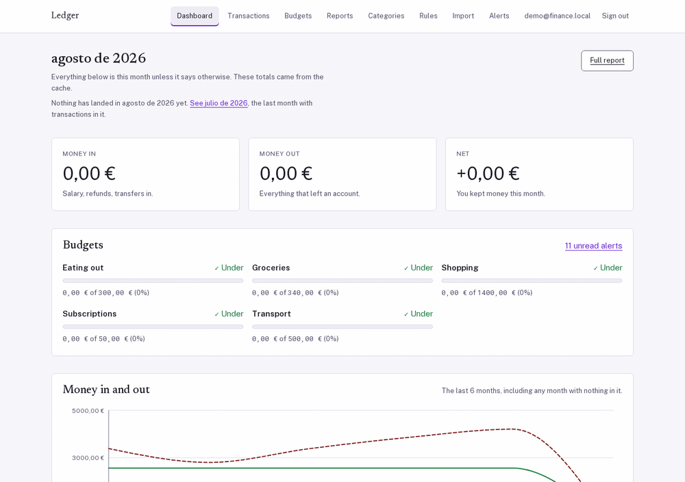

# Finance tracker: a ledger that refuses to be wrong about money

[](https://github.com/bastian-red/finance-tracker/actions/workflows/ci.yml)

Income and expenses, categorised by rules you write, budgeted per category per month, charted over
time, and imported from whatever CSV your bank exports. Next.js 14 and NestJS 10 over PostgreSQL 16
and Redis 7, in a pnpm/Turborepo monorepo.

The interesting part is not the CRUD. It is that **every way this app could quietly be wrong about
money is closed by something that cannot be forgotten**: amounts are integer minor units and never
touch a float, two budgets for one category can never cover the same month because a GiST `EXCLUDE`
constraint says so, a statement row that is already in the ledger is found by a server-side
fingerprint rather than by trusting the file, and the same import run twice produces the same ledger.
Each of those is a database or a pure function, not a code review habit, and each has a test that
goes red when you take it away.



## The five properties, and the test that proves each

| #   | Property                                   | Where it lives                                                   | What proves it                                                                                                                                         |
| --- | ------------------------------------------ | ---------------------------------------------------------------- | ------------------------------------------------------------------------------------------------------------------------------------------------------ |
| 1   | Two budgets for one category never overlap | `packages/db/prisma/migrations/20260801121000_ledger_invariants` | fires two simultaneous `POST /budgets` for the same period; exactly one wins, the loser gets a 409 naming the period it hit                            |
| 2   | Money is never a float                     | `packages/shared/src/money/`                                     | parses `1.234,56 €`, `$1,234.56` and `-52,40` to exact minor units; formats them back through `Intl` with the expected values computed, never recalled |
| 3   | Re-importing a statement changes nothing   | `services/import/src/preview.ts` + `apps/api/src/imports/`       | uploads the same file twice; the second run reports every row `duplicate` and writes zero transactions                                                 |
| 4   | A stale dashboard is impossible            | `apps/api/src/reports/report-cache.ts`                           | writes a transaction, reads the report, gets the new number; then kills Redis and still gets a correct, uncached answer                                |
| 5   | One alert per budget per month, ever       | `apps/api/src/alerts/alerts.service.ts`                          | crosses a limit twice; the `@@unique([budgetId, month, level])` violation is the "already sent" signal, and Mailhog holds exactly one message          |

## Money is an integer, and `Intl` is fed a string

Every amount in this codebase is an `int4` of minor units, branded as `Minor` so a bare `number`
cannot be assigned to one by accident. There is no `Decimal`, no `bignumber.js` and no `float8`
anywhere in the schema.

The half of this that is easy to get wrong is not the arithmetic, it is the **formatting**. The
formatter is handed a string, never a float:

```ts
// packages/shared/src/money/money.ts
new Intl.NumberFormat(locale, { style: 'currency', currency }).format(
  minorToDecimalString(amountMinor, exponentOf(currency)),
);
```

`format(-52.4)` and `format('-52.40')` agree today. They stop agreeing the moment an amount needs
more precision than a double carries exactly, and the failure is a rounding error in a total that
nobody notices for a month. Building the decimal string by integer division and padding means the
value handed to `Intl` is exactly the value in the column.

The tests that pin this follow one rule: **an expected value is
deterministic work too.** `es-ES` renders `1234,56 €` and not `1.234,56 €`, and the character before
the symbol is U+00A0, not a space. Both facts were produced by running node and pasting the output.
A wrong expectation does not merely fail; it invites you to "fix" correct code until the test passes,
and then defends the bug.

## Why the budget constraint is in Postgres

A budget is a category, a limit, and a half-open range of months. Two budgets for the same category
must never cover the same month, or "how much of my food budget is left in March" has two answers.

The obvious implementation is a `findFirst` before the insert. It does not work, and it does not fail
in an exotic way: two browser tabs both pass the lookup and both insert, which is what happens when
somebody double-clicks Save.

```sql
-- packages/db/prisma/migrations/20260801121000_ledger_invariants/migration.sql
ALTER TABLE "budgets"
  ADD CONSTRAINT "budgets_no_overlapping_periods"
  EXCLUDE USING gist (
    "category_id" WITH =,
    daterange("effective_from", "effective_to", '[]') WITH &&
  );
```

`btree_gist` is what lets a `uuid`-shaped equality live in the same GiST index as a range overlap.

The consequence shapes `apps/api/src/budgets/budgets.service.ts` more than anything else in the API.
**A constraint violation aborts the entire Postgres transaction** (`25P02`). Catching the `23P01` in
TypeScript does not un-abort it: every subsequent statement fails with "current transaction is
aborted", which is an error about the recovery code rather than about the conflict, thrown a long way
from the write that caused it. So the budget write is its own statement, never inside `$transaction`,
and that is what makes the recovery legal:

```
POST /budgets  ──▶ INSERT ──▶ 23P01
                                │
                                ▼
                     SELECT the budget that overlaps      ← legal only outside a transaction
                                │
                                ▼
   409 "Another budget for this category already covers 2026-01 to 2026-03,
        which overlaps 2026-02 onwards."
```

## How a bank statement becomes a ledger

`services/import` is a pure package. No database handle, no filesystem, no clock, no environment
lookup. Everything it needs is an argument, which is what lets `apps/api` call it inside a request
without the parser knowing a request exists, and what lets its 54 tests run a whole statement through
the pipeline in a millisecond with three literals.

```
bytes ──▶ decode ──▶ sniff delimiter ──▶ find header ──▶ map columns ──▶ detect date format
             │            │                   │               │                │
          BOM, UTF-16,  ; , \t |         up to 5 rows    date/desc/amount   DD/MM vs MM/DD,
          latin1 fallback                    deep         credit/balance    ambiguity flagged
                                                                                  │
                                                                                  ▼
                                       rows ──▶ parse amount ──▶ apply rules ──▶ fingerprint
                                                     │                │              │
                                              1.234,56 vs 1,234.56  regex+keyword   SHA-256 of
                                              decided per file       compiled once  (account, day,
                                                                                     amount, desc)
```

Three decisions in there are worth naming.

**The decimal separator is decided per file, not per locale.** A statement whose amounts read
`1.234,56` has both separators present and settles itself. One that reads `1.234` has neither, and
the file carries no evidence at all, so `DEFAULT_LOCALE` breaks the tie and the preview says it did.
`decimalAmbiguous` is on the wire so the UI can show it and let the reader correct it.

**Duplicate detection is server-side and window-bounded.** A row matches an existing transaction if
the amount and the normalised description agree and the days are within `DUPLICATE_WINDOW_DAYS`, or
if the bank's own `externalId` matches. The ledger rows to compare against are fetched over the
file's own date range widened by that window, which is why the preview is built twice: the first pass
exists only to learn the range. Fetching every transaction on the account would be a full table read
per upload; guessing a window is a duplicate that slips through the moment somebody imports a
two-year-old statement.

**The fingerprint never goes on the wire.** `PlannedRow` carries a `fingerprint` and a `merchant`;
`ImportPreviewRow`, the shared contract, does not. A fingerprint the client can see is one the client
can send back, and the whole point of computing it from the account id on the server is that it is
not supplied alongside one. The two travel beside each other, keyed by line number, and the commit
uses the server-side half.

The uploaded bytes are kept, content-addressed at `<IMPORT_ROOT>/<userId>/<sha256>.csv`, so the
preview is a pure function of the file rather than of a table that could drift from it. Re-uploading
a byte-identical statement resumes the existing import instead of creating a second one, and the
`imports_user_id_sha256_key` unique index is what enforces that rather than a lookup that races.

## Why the report cache is a version counter

The monthly report is an aggregate over every transaction in a range, joined against budgets. It is
cached in Redis. The interesting part is the invalidation, which is a counter and not a delete:

```
write ──▶ commit ──▶ INCR report:ver:{userId}          (after the commit, never before)
read  ──▶ GET  report:ver:{userId}  ──▶ v             (before the query, never after)
      ──▶ GET  report:{userId}:{month}:{v}
```

`DEL` has a race with any read that is already in flight: the reader fetches from Postgres, the
writer commits and deletes, the reader writes its now-stale value into the key it just missed. A
version in the key means a stale value is written under a key nobody will ask for again.

**Redis being down is not a 500.** Every cache call degrades to an uncached read, and the rate
limiter does the same thing for the same reason: `ResilientThrottlerGuard` allows the request and
logs it when its storage is unreachable, because fail-closed would turn a cache outage into a total
outage of an API that has a working database.

`SUM(int4)` comes back from Postgres as `bigint`, Prisma hands that over as a JavaScript `BigInt`,
and `JSON.stringify` **throws** on a `BigInt`. The conversion happens once, at the query boundary, in
`apps/api/src/common/numbers.ts`. Without it the report route answers 500 with a `TypeError` about
serialisation and nothing about money.

## Run it

```bash
git clone https://github.com/bastian-red/finance-tracker.git
cd finance-tracker
pnpm install

cp .env.example .env
# AUTH_SECRET is the only value you must fill in:
printf 'AUTH_SECRET=%s\n' "$(openssl rand -base64 32)" >> .env

docker compose -f infra/docker-compose.yml up -d   # Postgres, Redis, Mailhog
pnpm db:deploy                                     # migrations
pnpm db:seed                                       # a year of demo ledger

pnpm dev
```

Then open http://localhost:3000 and sign in:

| Account              | Password             |
| -------------------- | -------------------- |
| `demo@finance.local` | `demo-password-1234` |

The seed writes 747 transactions across 14 months, two accounts, ten categories, budgets that are
deliberately over, under and near their limits, the rules that categorise them, and the 27 alerts
those budgets raised along the way. The alerts are computed by walking each month's spending day by
day and recording the moment a threshold was actually crossed, so an "approaching" row never shows
102% used. Outbound alert mail lands in Mailhog at http://localhost:8029, not in anyone's inbox.

`pnpm dev` points at `scripts/dev.sh`, not at `turbo run dev`, and that is deliberate. Turbo does not
read dotenv files and Next.js only reads a `.env` inside its own package directory, so `turbo run
dev` starts an API with no `AUTH_SECRET`, which dies at boot, and every server render then fails with
`ECONNREFUSED` against it. The wrapper sources `.env`, checks `AUTH_SECRET`, probes Postgres and
Redis with bash's own `/dev/tcp` (because `nc` is not installed everywhere), and then execs turbo.

### Health

```bash
curl -s localhost:4000/health | jq
```

```json
{
  "status": "ok",
  "version": "0.1.0",
  "uptimeSeconds": 20,
  "checks": [
    { "name": "postgres", "status": "ok", "latencyMs": 15, "detail": null },
    { "name": "redis", "status": "ok", "latencyMs": 7, "detail": null }
  ]
}
```

It round-trips both dependencies rather than reporting on a connection object. Stop the Postgres
container and the endpoint goes non-ok with the reason, which is the only version of a health check
worth having.

## Tests

Five lanes, three of them free.

```bash
pnpm test                    # gate: 913 unit tests in 55 files, no network, no DB
pnpm env:contract            # the four-way env agreement, instant
pnpm scan:invisible          # no character in source that a reviewer cannot see
./scripts/dev-smoke.sh       # boots the documented `pnpm dev` and asserts real content
./scripts/integration.sh     # real Postgres + real Redis
./scripts/e2e.sh             # 136 Playwright tests, including axe over every route
```

There are no LLM evals here: this project has no AI feature to measure.

Two of those lanes exist because of a failure that got past every other one.

**`dev-smoke.sh` walks every route in the nav**, not the two the README happens to name. It reads the
hrefs out of `apps/web/components/nav.tsx` and asserts each answers 200, carries the signed-in chrome,
and contains a string only a database-backed render produces. `GET /budgets/status` was missing from
the API's controller: `/budgets` answered 500 while `/`, `/transactions` and all 886 unit tests stayed
green. Two probed routes cannot catch a third route being broken.

**`scripts/invisible-chars.mjs` refuses a character you cannot see.** A raw U+0000 inside a template
literal rendered as `${categoryId} ${month}` in every editor and every diff, and four unit tests
written against what the source appeared to say failed with `expected undefined` against code that was
correct. The obvious next move, "the code must be wrong", would have been wrong. It has its own
self-test, for the same reason `env-contract.mjs` does: a gate nobody tests can only be discovered to
be broken by the outage it was supposed to prevent.

And one bug that only Playwright could find: `signInAction` called `await auth()` after
`signIn(..., { redirect: false })` to confirm the session had been created. That cookie is on the
_response_; `auth()` reads the _request_, so it returned null and every correct password was answered
with "the sign-in did not produce a session". `dev-smoke.sh` and a manual `curl` both missed it,
because both post straight to Auth.js's credentials callback and never touch the server action. The
E2E suite failed 35 tests on it in two browsers, on the first run.

**A lane that supplies its own environment proves nothing.** `dev-smoke.sh` launches with every name
from `.env.example` stripped out of its environment (`env -u`, derived by parsing the file rather
than by a hand-kept list), and its CI job carries no job-level `env:` block. That is the check that
catches "the documented `pnpm dev` is broken" while every other lane stays green, which is exactly
what happened in three sibling projects.

**Assert on content, never on a status code.** A broken app answers 200 with an error page. The smoke
check greps for a seeded product of a working request, not for `HTTP/1.1 200`.

### See it for yourself

```bash
# 1. The importer reads a Spanish bank export: latin1, semicolons, DD/MM/YYYY, comma decimal
curl -s -X POST localhost:4000/imports \
  -H "Authorization: Bearer $TOKEN" \
  -F accountId="$ACCOUNT" -F file=@services/import/fixtures/bbva-es.csv | jq .format

# 2. The same file again is refused, because it is byte-identical
curl -s -o /dev/null -w '%{http_code}\n' -X POST localhost:4000/imports \
  -H "Authorization: Bearer $TOKEN" \
  -F accountId="$ACCOUNT" -F file=@services/import/fixtures/bbva-es.csv     # 409

# 3. Money never becomes a float: the stored line is verbatim, the amount is an integer
psql "$DATABASE_URL" -c \
  "SELECT line_number, amount_minor, raw FROM import_rows ORDER BY line_number LIMIT 3;"
```

## Design: violet on cool paper, and colour is never the only channel

One surface, one audience, one job: a person looking at their own money. The palette is pinned by a
test so a redesign that drifts fails the commit.

|          | Value                                                                |
| -------- | -------------------------------------------------------------------- |
| Canvas   | `#f7f6fb` light / `#12111a` dark                                     |
| Accent   | violet `#6d28d9` / `#a78bfa`                                         |
| Type     | Newsreader for headings, Public Sans for UI, Roboto Mono for figures |
| Geometry | 6px radius, 4px spacing base, 68ch measure                           |
| State    | semantic colour **plus** a glyph **plus** a word, always             |

That last row is not a style preference, it is a measured impossibility. An exhaustive search over
the full 500–900 and 300–600 colour ramps found **zero** combinations where green, amber and red all
clear 4.5:1 against this canvas _and_ separate by 1.5:1 from each other in greyscale. The best
available pairs are 2.0:1 in light mode and 2.6:1 in dark. So colour is the third channel here, never
the first: a budget state and a transaction direction each carry a glyph and a word beside the
colour, and `contrast.test.ts` asserts only the two genuinely confusable pairs, with the reason in a
comment so nobody "fixes" it later.

Charts follow the `dataviz` rules. The by-category chart is a **sorted single-hue horizontal bar
chart and deliberately not a donut**: a ten-slice pie needs ten categorical hues to carry identity,
ten hues cannot pass a colour-vision check at any lightness, and the fallback is a legend that asks
the reader to map a colour back to a name ten times. A sorted bar carries rank in position and
identity in a label against the bar, so colour carries nothing and is free to be one hue. The trend
chart has **one** axis, the expense series is dashed so its identity survives greyscale, and every
chart has a `<details>` table alternative. No chart is ever wrapped in `aria-hidden`: Recharts makes
its surface focusable, and hiding a subtree containing focusables is itself a WCAG failure.

### Measured, not asserted

Every number below was produced by running the check named beside it, not by estimating.

| Outcome                                        | Measured                               | Enforced by                              |
| ---------------------------------------------- | -------------------------------------- | ---------------------------------------- |
| axe-core violations, 9 routes × 2 schemes      | **0** of 18 scans                      | `e2e/tests/a11y.spec.ts`                 |
| Foreground/background pairs below WCAG AA      | **0** of 86 measured pairs             | `apps/web/lib/contrast.test.ts`          |
| `var(--x)` references resolving to nothing     | **0**                                  | `apps/web/lib/tokens.test.ts`            |
| Classes a component uses with no CSS rule      | **0**                                  | `apps/web/lib/classnames.test.ts`        |
| Table rows repainting under status ink         | **0**                                  | `apps/web/lib/contrast.test.ts`          |
| Invisible characters in source                 | **0** across 284 files                 | `scripts/invisible-chars.mjs`            |
| Env names read but never declared to turbo     | **0** of 29 read                       | `scripts/env-contract.mjs`               |
| Signed-in routes that render from the database | **8** of 8                             | `scripts/dev-smoke.sh`                   |
| Unit tests                                     | **913** in 55 files, under 3s          | `pnpm test`, on every commit             |
| E2E tests                                      | **136**, Chromium and Firefox, 0 flaky | `./scripts/e2e.sh`                       |
| Identity drift across the portfolio            | no shared canvas, accent or typeface   | `identity-distinct.mjs` (local, 4 repos) |

## Architecture

One request, from a keystroke to a row:

```
browser
   │  session cookie (Auth.js, JWT strategy — no session table)
   ▼
apps/web            Next.js 14, App Router. Owns the browser session.
   │  server component calls lib/session.authedRequest()
   │  mintServiceToken(): HS256, 5 minutes, signed with AUTH_SECRET
   ▼  Authorization: Bearer …
apps/api            NestJS 10. Holds no session state at all.
   │  ServiceTokenGuard verifies with algorithms: ['HS256'] named explicitly
   │  ZodValidationPipe parses against packages/shared/src/contracts
   ▼
   ├──▶ PostgreSQL 16    the invariants: EXCLUDE, CHECK, triggers, unique indexes
   ├──▶ Redis 7          report cache (a version counter), rate limit budgets
   └──▶ SMTP             budget alerts. Allowed to fail; the alert row is written anyway.

           the API calls three pure packages, none of which does any I/O:

           services/import        bytes → rows. No db handle, no clock, no env.
           services/categorize    rules → a match, with a ReDoS probe ladder
           services/notifications alert planning and rendering. Pure until `send`.
```

The two halves share exactly one secret and one set of zod schemas. Nothing else crosses: the web
tier has no database connection, and the API has no idea a browser exists.

```
finance-tracker/
├── apps/
│   ├── api/                 NestJS 10. Holds no session; verifies a service token per request.
│   │   ├── src/imports/     upload → preview → correct format → commit
│   │   ├── src/budgets/     the EXCLUDE constraint and its error message
│   │   ├── src/reports/     rollups + the Redis version-counter cache
│   │   └── src/alerts/      budget threshold evaluation and delivery
│   └── web/                 Next.js 14 App Router. Owns the browser session (Auth.js).
├── services/
│   ├── import/              pure CSV/statement parser. No I/O of any kind.
│   ├── categorize/          rule compilation + matching, with a ReDoS probe ladder
│   └── notifications/       alert planning, rendering and channels. Pure until `send`.
├── packages/
│   ├── db/                  Prisma schema, migrations, seed
│   ├── shared/              money, time, contracts (zod). Imported by both sides.
│   └── config/              tsconfig and eslint bases
├── e2e/                     Playwright, including axe over every route in both schemes
├── infra/                   docker-compose + a Dockerfile per service
└── scripts/                 dev, smoke, e2e, integration, env-contract, a11y baseline
```

**The API holds no session.** The web app owns the browser session and mints a 5-minute HS256 token
per server-side call, signed with the `AUTH_SECRET` both processes already share. The guard verifies
it with `algorithms: ['HS256']` named explicitly, because leaving the algorithm list open is how a
`none`-algorithm token gets accepted. No cookie, no session table, no database round trip on the auth
path.

**Every constructor parameter carries an explicit `@Inject`.** The test lane transpiles with esbuild,
which implements `experimentalDecorators` but not `emitDecoratorMetadata`, so an implicit constructor
parameter has no `design:paramtypes` entry and Nest injects `undefined`, and it fails as a
500 at request time rather than at boot. Every constructor in this API is written the explicit way.

### Database invariants

Nothing in the service layer is trusted to maintain these.

| Invariant                                             | Mechanism                                        |
| ----------------------------------------------------- | ------------------------------------------------ |
| Two budgets for one category never overlap            | `EXCLUDE USING gist` + `btree_gist`              |
| A budget limit is positive                            | `CHECK ("limit_minor" > 0)`                      |
| A budget period starts on the 1st and ends ordered    | two `CHECK`s                                     |
| A transaction's currency matches its account          | `BEFORE` trigger, raises with a named constraint |
| A transaction's user matches its account and category | same trigger                                     |
| An alert month is the 1st                             | `CHECK (EXTRACT(DAY FROM "month") = 1)`          |
| One alert per budget per month per level              | `@@unique([budgetId, month, level])`             |
| A statement is imported once                          | `@@unique([userId, sha256])`                     |
| A bank's own id is unique per account                 | `@@unique([accountId, externalId])`              |
| The monthly rollup is index-only                      | covering index with `INCLUDE`                    |
| The uncategorised queue is cheap                      | partial index                                    |
| Description search is not a table scan                | `pg_trgm` GIN index                              |

## Ports

Chosen so the whole portfolio can run at once.

| Service      | Port |
| ------------ | ---- |
| Web          | 3000 |
| API          | 4000 |
| Postgres     | 5436 |
| Redis        | 6383 |
| Mailhog SMTP | 1029 |
| Mailhog UI   | 8029 |
